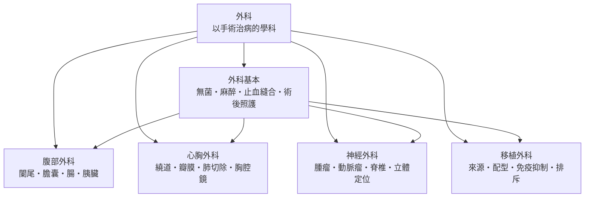

# 外科

> 隸屬第一層 [醫]　·　相關分類：[解剖學]、[病理學]、[藥理學]　·　子分類總表見 [README]

> 對應維基百科：[中文維基百科：外科学](https://zh.wikipedia.org/wiki/%E5%A4%96%E7%A7%91%E5%AD%A6)　·　[English Wikipedia: Surgery](https://en.wikipedia.org/wiki/Surgery)

外科是以**手術**處理疾病的醫學分支：用切開、切除、修補、移植與重建，直接改變身體的結構來治療病灶。它與以藥物治療為主的 [內科] 形成互補——內科處理「身體的功能出了什麼問題」，外科處理「身體的結構壞在哪裡、能不能動手修」。外科的每一步都建立在 [解剖學] 的空間知識與 [病理學] 的診斷判斷之上：先知道器官長在哪裡、怎麼供血，才知道從哪裡進去；先知道病變是什麼、長到哪裡，才知道切多少。

## 核心問題

外科的核心問題可以濃縮成一句話：**如何在不把病人殺死的情況下，把病灶拿掉並讓身體恢復功能？**這句話拆開來是三個瓶頸：

1. **痛**：手術必然造成劇烈疼痛與休克，病人往往死在手術台上而非病灶本身。
2. **感染**：切開皮膚就是打開身體的防線，十九世紀的手術死亡率過半源於術後感染。
3. **出血與損傷**：手術是對身體的有意創傷，控制出血、保護正常組織是技術的本體。

三個瓶頸對應三個支柱：麻醉（1846 年乙醚麻醉公開演示成功，見 [1846年]）、抗菌與無菌（李斯特於 [1865年] 首用石炭酸抗菌，見 [李斯特]），以及止血、縫合與輸血等基本技術。三者齊備之後，手術才從極端手段變成常規治療。

## 因果鏈

1. **前麻醉時代**：手術速度就是一切——切腿以「分鐘」計，疼痛與休克讓大手術幾乎不可行。
2. **麻醉誕生**：[1846年] 乙醚麻醉公開演示成功，病人首次能在無痛狀態下接受手術，醫師有時間做精細操作。
3. **感染壁壘**：麻醉普及後，術後膿毒反而成為主要死因；「醫院病」被視為宿命，直到塞麥爾維斯與李斯特提出感染可防。
4. **抗菌到無菌**：李斯特的石炭酸法（[1865年]）演進為蒸汽滅菌、手套與手術室的無菌常規，體腔手術首次變得安全。
5. **解剖與病理的支撐**：[解剖學] 的區域解剖與 [病理學] 的診斷分期，使手術從「切掉看得到的」進步到「按原則切乾淨」。
6. **體腔與專科分化**：腹部、胸腔、顱腔相繼被打開，手術技術依器官分化出 [腹部外科]、[心胸外科]、[神經外科] 等專科。
7. **移植與替代**：免疫抑制藥物使異體器官可以存活，[1954年] 首例成功腎臟移植開啟 [移植外科] 時代（見 [1954年]）。
8. **微創與影像導引**：內視鏡、影像導航與機器手臂把「大切口」縮成幾個小孔，手術創傷與住院日大幅下降。

## 子分類的定位與相互驅動

- [外科基本] 是**地基**：無菌技術、麻醉、止血縫合與術後照護是所有專科手術共用的底層技術；沒有這一層，任何專科都不存在。
- [腹部外科] 是**起點專科**：胃腸手術最先成熟，其發展出的腸道吻合、引流與營養支持技術，成為其他專科借用的範本。
- [心胸外科] 是**生理學的考驗**：心肺是循環與呼吸的中樞，手術必須先解決體外循環與肺隔離，把 [生理學] 直接變成手術台的工程問題。
- [神經外科] 是**精密度的極限**：腦與脊髓不可再生，定位誤差以毫米計，推動了立體定位與影像導航技術。
- [移植外科] 是**免疫學的勝利**：移植的成敗不在刀法而在免疫，配型與免疫抑制使「換器官」從幻想變成常規。

## 範例：急性闌尾炎的一台手術，五層技術全上場

1. **診斷**：右下腹痛、發燒、白血球上升，臨床判斷為急性闌尾炎——切除與否取決於 [病理學] 式的判斷。
2. **無菌**：術前皮膚消毒、鋪無菌單、器械滅菌——[無菌技術] 防止把皮膚上的菌帶進腹腔。
3. **麻醉**：全身或脊椎麻醉使腹肌鬆弛、病人無痛——麻醉是手術得以進行的第一前提。
4. **操作**：切開腹壁、結紮闌尾動脈（止血）、切除闌尾、荷包縫合包埋殘端（縫合）——[外科基本] 的核心動作。
5. **照護**：術後禁食至腸道排氣、止痛、觀察感染徵象——[術後照護] 決定手術的最終成敗。

## 容易混淆之處

- **外科不等於開刀**：外科是一門判斷「何時該開刀、何時不該」的學問；越成熟的外科醫師，越常「選擇不開」。
- **麻醉不是「睡一覺」**：麻醉醫師同時管理呼吸、循環與體溫，是手術安全的守門人。
- **微創不等於微風險**：小切口不改變疾病的嚴重性，腹腔鏡手術同樣可能中轉開腹。
- **手術成功不等於治癒**：惡性腫瘤切除乾淨仍可能復發，後續輔助治療由 [藥理學] 與腫瘤醫學接手。
- **急診手術與擇期手術不同**：前者在資訊不全下搶時間，後者可充分評估，風險結構完全不同。

## 延伸閱讀

- [解剖學]：手術地圖的座標系。
- [病理學]：決定切什麼、切多少的診斷基礎。
- [藥理學]：麻醉藥、抗生素與免疫抑制劑的機制。
- [內科]：外科的鏡像與合作夥伴。
- [急診醫學]：外傷與急症手術的第一現場。
- [免疫系統]：移植與感染的免疫基礎。

## 連結定義

[醫]: ../README.md
[README]: README.md
[解剖學]: ../解剖學/README.md
[生理學]: ../生理學/README.md
[病理學]: ../病理學/README.md
[藥理學]: ../藥理學/README.md
[內科]: ../內科/README.md
[急診醫學]: ../急診醫學/README.md
[免疫系統]: ../免疫系統/README.md
[外科基本]: 外科基本.md
[腹部外科]: 腹部外科.md
[心胸外科]: 心胸外科.md
[神經外科]: 神經外科.md
[移植外科]: 移植外科.md
[無菌技術]: 無菌技術.md
[術後照護]: 術後照護.md
[李斯特]: ../../人/醫學家/李斯特.md
[1846年]: ../../時/1846年.md
[1865年]: ../../時/1865年.md
[1954年]: ../../時/1954年.md