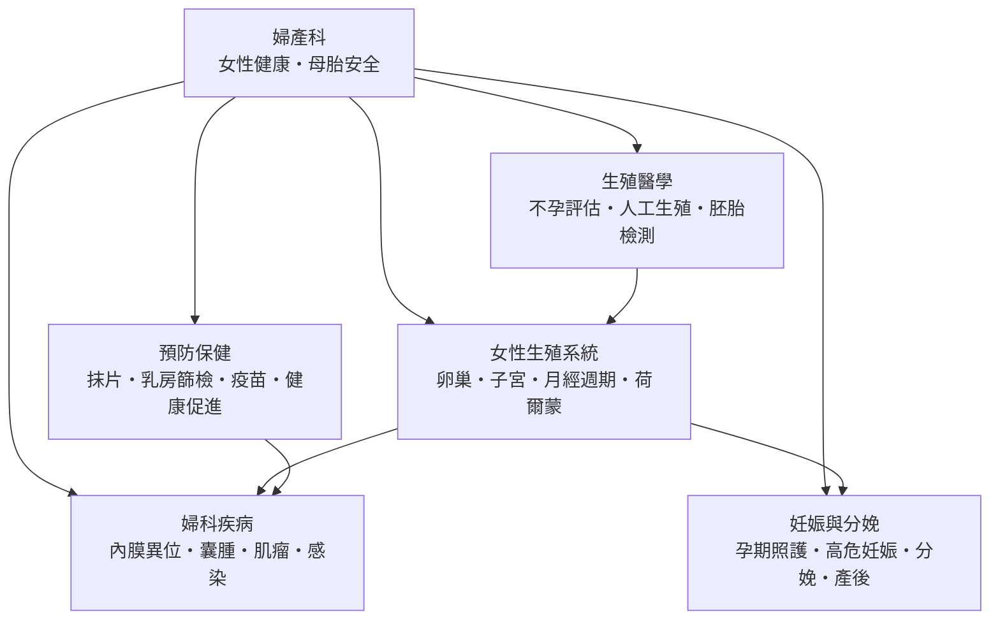

# 婦產科

> 隸屬第一層 [醫]　·　相關分類：[解剖學]、[內科]、[遺傳學]　·　子分類總表見 [README]

> 對應維基百科：[中文維基百科：婦產科學](https://zh.wikipedia.org/wiki/%E5%A9%A6%E7%94%A2%E7%A7%91%E5%AD%B8)　·　[English Wikipedia: Obstetrics and gynaecology](https://en.wikipedia.org/wiki/Obstetrics_and_gynaecology)

婦產科是**婦科**（gynecology，診治女性生殖系統的疾病）與**產科**（obstetrics，管理懷孕、分娩與產後）的合稱。它是一門「同時照顧兩個人」的學科：懷孕期間，母體與胎兒共享一個循環與代謝環境，任何治療決策都必須同時計算兩邊的風險。這種雙主體結構使婦產科在醫學中獨樹一格——它既是外科（手術分娩、腫瘤切除）、又是內科（荷爾蒙、感染）、還是公共衛生（篩檢、疫苗）的交會處。

## 核心問題

婦產科的核心問題是：**如何在維持女性健康與生育能力的同時，讓懷孕與分娩對母子都安全？**拆開來是三條主線：

1. **結構與功能的維持**：卵巢、子宮與其荷爾蒙軸決定了月經、生育與骨骼心血管健康；理解 [女性生殖系統] 是一切的前提。
2. **懷孕的管理**：約 $15\%$ 的已知妊娠以流產告終，妊娠高血壓、前置胎盤等合併症則考驗著「什麼時候該讓胎兒提早出生」的判斷，這是 [妊娠與分娩] 的核心。
3. **疾病的預防與治療**：子宮頸癌是少數「已知病因、可篩檢、可疫苗預防」的癌症，預防策略的成熟使 [預防保健] 從附屬工作變成婦產科的主角之一。

## 因果鏈

1. **解剖與生理的奠基**：[解剖學] 對骨盆結構與 [生理學] 對荷爾蒙週期的闡明，使月經失調、不孕有了可解釋的機制，而非「體質」。
2. **產科感染的慘痛教訓**：十八至十九世紀產褥熱橫行產房，塞麥爾維斯以洗手使死亡率驟降卻遭同業排斥，直到 [李斯特] 的抗菌原則（[1865年]）確立——產科是感染控制的最早戰場之一。
3. **剖宮產的安全化**：麻醉與消毒讓剖宮產從絕境手術變成常規，難產不再意味著母子只能活一個。
4. **荷爾蒙醫學的誕生**：排卵的內分泌機制被闡明後，口服避孕藥（1960 年）、排卵誘導與荷爾蒙補充相繼出現，生育從「聽天由命」變成「可調控」。
5. **生殖醫學革命**：[1978年] 首例試管嬰兒誕生，體外受精使輸卵管阻塞、男性不孕等長期絕境有了出路，見 [1978年]。
6. **癌症預防的典範**：子宮頸抹片篩檢使子宮頸癌死亡率下降逾七成；人類乳突病毒疫苗（見 [疫苗]）更把預防推進到「接種即防癌」。
7. **微創與影像**：腹腔鏡、陰道超音波與胎兒超音波使婦科手術微創化、胎兒畸形可產前診斷，母胎醫學成為獨立次專科。

## 子分類的定位與相互驅動

- [女性生殖系統] 是**基礎**：卵巢與子宮的結構、月經週期的荷爾蒙軸，是理解所有婦科疾病與懷孕生理的語言。
- [妊娠與分娩] 是**產科主體**：孕期照護把風險前移、高危妊娠管理與分娩方式的選擇，直接決定母子結局。
- [婦科疾病] 是**臨床主體**：子宮內膜異位、肌瘤與感染占婦科門診的大宗，診治能力以 [女性生殖系統] 的知識為地基。
- [生殖醫學] 是**生育的工程學**：不孕評估、人工生殖與胚胎檢測把 [女性生殖系統] 的生理知識轉成可操作的技術。
- [預防保健] 是**公共衛生前哨**：抹片、乳房篩檢與疫苗把疾病攔截在症狀之前，是本領域投入產出比最高的一環。

## 範例：一位女性的婦產科生命旅程

1. **青春期**：月經初潮與週期建立——[月經週期] 的荷爾蒙軸開始運作，原發性無月經則需評估 [荷爾蒙失調]。
2. **生育期**：避孕選擇、子宮頸抹片與 HPV 疫苗（[疫苗]）——[預防保健] 的主戰場。
3. **懷孕**：產檢確認週數與胎位、妊娠糖尿病篩檢、選擇陰道分娩或剖宮產——[妊娠與分娩] 的全程管理。
4. **婦科疾病**：經痛加劇發現 [子宮內膜異位]，腹腔鏡診斷與治療——微創手術保留生育能力。
5. **更年期後**：荷爾蒙補充的利弊評估、骨質與心血管風險管理——婦產科照護延伸到生殖功能停止之後。

## 容易混淆之處

- **婦科與產科不同**：婦科管疾病、產科管懷孕；同一位醫師通常兩者都執業，但問題結構完全不同。
- **月經不規則不等於不孕**，反之規則月經也不保證排卵——排卵確認要靠證據（黃體素、超音波）。
- **剖宮產不是「比較安全」的預設選項**：對低風險懷孕，計畫性陰道分娩的恢復與再次懷孕風險整體更優。
- **子宮肌瘤是良性腫瘤**：多數無症狀、不需手術；「有肌瘤」與「需要切除肌瘤」之間隔著症狀與生育計畫的評估。
- **抹片與 HPV 檢測不同**：抹片看細胞形態、HPV 檢測查病因，兩者常並行但意義不同。

## 延伸閱讀

- [解剖學]：骨盆與生殖器官的結構。
- [生理學]：內分泌軸的運作原理。
- [遺傳學]：胚胎檢測與產前診斷的基礎。
- [內科]：妊娠合併內科疾病的處理。
- [公共衛生]：篩檢與疫苗政策的場域。
- [兒科]：新生兒端的銜接。

## 連結定義

[醫]: ../README.md
[README]: README.md
[解剖學]: ../解剖學/README.md
[生理學]: ../生理學/README.md
[遺傳學]: ../遺傳學/README.md
[內科]: ../內科/README.md
[公共衛生]: ../公共衛生/README.md
[兒科]: ../兒科/README.md
[女性生殖系統]: 女性生殖系統.md
[妊娠與分娩]: 妊娠與分娩.md
[婦科疾病]: 婦科疾病.md
[生殖醫學]: 生殖醫學.md
[預防保健]: 預防保健.md
[月經週期]: 月經週期.md
[荷爾蒙失調]: 荷爾蒙失調.md
[子宮內膜異位]: 子宮內膜異位.md
[疫苗]: ../../物/疫苗.md
[李斯特]: ../../人/醫學家/李斯特.md
[1865年]: ../../時/1865年.md
[1978年]: ../../時/1978年.md