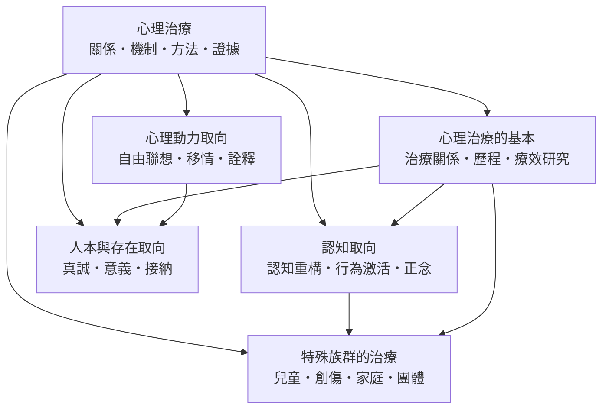

# 心理治療

> 隸屬：第一層 [醫]　·　相關分類：[精神醫學]、[臨床心理學]、[心理學]　·　子分類總表見 [README]

> 對應維基百科：[中文維基百科：心理治療]　·　[English Wikipedia: Psychotherapy]

心理治療是**以系統性的心理方法處理情緒困擾、行為問題與心理疾患的專業實務**。它與藥物治療的差別不在「不用藥」而已，而在介入的單位：藥物作用在神經傳導物質，心理治療作用在**想法、情緒、行為與關係的模式**上。它的核心主張是：這些模式是可以被理解、被檢驗、被改變的——改變可以發生在認知層（怎麼想）、行為層（怎麼做）、情感層（怎麼感受）與關係層（怎麼與人相處），而不同治療取向只是選擇了不同的切入點。

因此，心理治療既是一門技術，也是一門研究對象。一個取向要成立，必須回答三個問題：它對「心理困擾從哪裡來」有什麼理論？它憑什麼宣稱自己的介入有效？它的效果能被獨立研究重複驗證嗎？第三個問題正是[療效研究]存在的理由——心理治療的合法性最終不靠大師的威望，而靠證據。

本概念的問題是：**一群從完全不同的人性假設出發的治療傳統，如何各自發展出方法、彼此競爭又互相吸收，最後匯流成以證據為準的現代心理治療**。

## 核心問題：改變如何發生

心理治療的核心問題可以拆成四個互相咬合的層次：

1. **問題的層次**：來談者帶進來的是什麼？是症狀（失眠、恐慌）、是模式（總是破壞親密關係）、還是意義危機（不知道為什麼活著）？不同層次的問題需要不同深度的介入。
2. **機制的層次**：治療為什麼有效？主流答案包括：新的關係經驗（[治療關係]）、新的認知框架（[認知重構]）、情緒的曝光與調節（暴露）、行為的改變帶動感受的改變（[行為激活]）。**沒有一個機制能解釋所有療效**。
3. **方法的層次**：理論必須翻譯成可操作的技術——怎麼開場、怎麼問、怎麼回應沉默、什麼時候詮釋、什麼時候只傾聽。
4. **證據的層次**：效果必須與不治療、與安慰劑、與其他治療比較。這是 [療效研究] 的戰場，也是心理治療從師徒傳承走向科學專業的分水嶺。

## 因果鏈

1. **前科學時代：道德治療與療養院**：十九世紀歐洲把精神病患從鐵鏈與監禁中解放，主張安靜環境、規律作息與人性化對待本身就有療癒力。這是「照顧的環境可以改變心理狀態」的第一次制度化實驗，也是心理治療的前身。

2. **[佛洛伊德] 與談話治療的誕生**：十九世紀末，[佛洛伊德] 在 [維也納] 從催眠轉向自由聯想，主張症狀是無意識衝突的妥協產物，而「說出來」本身能帶來改變。**心理困擾第一次被主張可以透過對話治療**，這奠定了心理動力取向的基礎。

3. **動力傳統的擴張與分化**：二十世紀上半葉，精神分析從維也納擴散到歐美，衍生出自我心理學、客體關係等分支；治療從一週多次、長達數年，逐漸發展出適應門診節奏的變體。**理論的分化同時暴露了問題：各家都有效果案例，卻沒有比較的標準**。

4. **行為主義的介入：把治療變成可測量的操作**：行為治療在 1950 年代興起，主張不需要假設無意識，直接以制約原理處理恐懼與症狀——系統減敏感法讓害怕蛇的人階梯式地面對恐懼。**治療目標第一次被寫成可觀察、可計次的行為改變**。

5. **人本主義的反叛**：[羅傑斯] 在 1940 至 50 年代主張治療的核心不是技術而是關係——真誠、無條件正向關懷與同理心。這把「治療師是誰」提升為變因，也催生了心理治療史上第一次大規模的療效錄音研究。

6. **認知革命的整合**：[貝克] 在 1960 年代針對憂鬱提出認知三角，主張情緒困擾來自扭曲的自動化思考；認知取向把行為技術與思考改變整合成認知行為治療（CBT），並以結構化、有手冊、可訓練的形式大量複製。**心理治療因此具備了被大規模試驗的條件**。

7. **療效研究與實證支持的制度化**：1990 年代起，美國心理學會等機構以隨機對照試驗為標準建立「實證支持治療」清單，認知行為取向累積的證據最多；同時「共同因子研究」發現各取向的療效差異其實不大，治療關係品質是跨取向的穩定預測因子。**證據逼出謙遜，也逼出整合**。

8. **整合取向與特殊族群的細化**：當代發展出折衷與整合取向，並針對兒童、創傷倖存者、家庭與團體發展專門的調整——[特殊族群的治療] 的存在本身說明：**沒有一種治療設定對所有人都成立**。

## 子分類的定位與相互驅動

- [心理治療的基本] 是**共同基礎**：不論取向，治療都需要關係、目標與歷程。[治療關係] 的品質是各取向共通的有效因子，[療效研究] 則是所有取向共同接受的裁判。這個子分類回答的問題先於任何取向之爭：**治療裡到底發生了什麼**。

- [認知取向] 是**當代主流**：它把「想法影響情緒、行為回饋想法」這個可操作的迴圈變成治療的核心，並以手冊化、短期化、可試驗化取勝。它的成功也回頭改變其他取向——連動力與人本傳統都開始採用結構化與效果測量。

- [心理動力取向] 是**深度與歷史的來源**：它貢獻了無意識、早期經驗與[移情]這些概念工具，主張症狀之下有模式、模式之下有歷史。雖然在實證競賽中失去主流地位，它的洞見被短期動力治療等變體保留下來，也持續滋養其他取向對「此時此地關係」的理解。

- [人本與存在取向] 是**價值的錨**：它提醒所有取向——治療對象不是症狀而是人，改變的前提是被理解與被接納。[意義治療] 把「為什麼活著」帶回治療室，[接納] 的概念後來被第三 wave 認知治療吸收，成為正念取向的基石。

- [特殊族群的治療] 是**壓力測試與出口**：兒童不會用成人的語言談自己，創傷需要安全感優先於詮釋，家庭與團體把治療單位從個人換成系統。**每一個特殊族群都逼理論承認自己的預設**——預設來談者能反思、能語言化、能單獨改變。

## 範例：一位憂鬱上班族走過五個子分類

以「35 歲上班族因長期失眠與無望感求診」為例，看五個子分類如何各自接手：

1. **[心理治療的基本] 先回答：治療可不可行**。初步評估確認沒有立即的自殺風險，接著建立治療契約——每週一次、每次 50 分鐘、目標是什麼。[治療關係] 從第一次會談就開始累積：治療師能否準時、能否記得上週說過什麼，都是來談者判斷「這裡安不安全」的證據。
2. **[認知取向] 處理症狀的主體結構**。評估發現他的自動化思考是「我做不好任何事」；治療師用行為紀錄反駁——他上週其實完成了七件工作事項。接著以 [行為激活] 排恢復性的小活動（散步、見一位朋友），因為**先動起來，情緒才有機會跟上**。十二至十六週的結構化療程是此取向的典型規模。
3. **[心理動力取向] 追問症狀底下的模式**。若症狀改善後他仍反覆陷入耗竭的關係，動力取向會探詢：他是否總在扮演「不能拒絕別人的人」？這個模式從哪裡學來？治療中他對治療師的過度配合，本身就是可以指認的 [移情] 材料。
4. **[人本與存在取向] 回答「然後呢」**。症狀緩解不等於活得有方向。此取向不給建議，而是幫他聽見自己：他真正想要的生活長什麼樣？被理解與被接納的體驗本身，就是此取向主張的改變機制。
5. **[特殊族群的治療] 檢查設定是否合適**。若他的困擾根源是婚姻衝突，個人治療的效果會被家庭系統每天抵銷，此時 [家庭治療] 把伴侶納入；若他曾經歷職場霸凌且出現閃回，則需要創傷知情的處理順序——先穩定，再處理記憶。
6. **回頭看整條鏈**：同一個人、同一份困擾，五個子分類問的是五個不同的問題——可行嗎、症狀怎麼解、模式從哪來、他要什麼、設定對不對。**好的臨床工作不是選邊站，而是知道每個問題什麼時候該被問**。

## 容易混淆之處

- **心理治療不等於諮商**：兩者重疊極大，但臨床上心理治療常指針對精神疾患的深度介入，諮商常指針對發展與適應議題的協助；各地的法規與訓練要求也不同。
- **「有療效」不等於「療效來自理論」**：共同因子研究顯示，各取向療效差異小而治療關係貢獻大；理論正確與治療有效是兩件事。
- **支持性會談不等於心理治療**：傾聽與安慰有價值，但治療另含系統性的目標、技術與評估。
- **手冊化不等於機械化**：認知行為治療的手冊是品質控制的工具，不是照稿念的腳本；治療師仍須依個案調整。
- **痊癒不是線性的**：症狀起伏是治療常態，惡化的一週不代表治療失敗；把退步解讀為失敗常使來談者中途退出。
- **心理治療不能取代所有醫療**：重度憂鬱、思覺失調等情境下，藥物與心理治療常需並行，取捨屬於 [精神醫學] 的協作判斷。

## 延伸閱讀

- [精神醫學]：診斷與藥物治療的主管學科，心理治療的臨床協作方。
- [臨床心理學]：心理衡鑑與心理治療的心理學基礎。
- [心理學]：所有治療理論的源頭學科。
- [發展心理學]：理解兒童與青少年個案的必備知識。
- [社會心理學]：人際動力與團體歷程的理論來源。
- [神經科學]：心理治療如何改變大腦的機制層解釋。

## 連結定義

[醫]: ../README.md
[README]: README.md
[精神醫學]: ../精神醫學/README.md
[臨床心理學]: ../../社會/臨床心理學/README.md
[心理學]: ../../社會/心理學/README.md
[發展心理學]: ../../社會/發展心理學/README.md
[社會心理學]: ../../社會/社會心理學/README.md
[神經科學]: ../神經科學/README.md
[佛洛伊德]: ../../人/心理學家/佛洛伊德.md
[羅傑斯]: ../../人/心理學家/羅傑斯.md
[貝克]: ../../人/心理學家/貝克.md
[維也納]: ../../地/維也納.md
[心理治療的基本]: 心理治療的基本.md
[治療關係]: 治療關係.md
[療效研究]: 療效研究.md
[認知取向]: 認知取向.md
[認知重構]: 認知重構.md
[行為激活]: 行為激活.md
[心理動力取向]: 心理動力取向.md
[移情]: 移情.md
[人本與存在取向]: 人本與存在取向.md
[意義治療]: 意義治療.md
[接納]: 接納.md
[特殊族群的治療]: 特殊族群的治療.md
[家庭治療]: 家庭治療.md
[中文維基百科：心理治療]: https://zh.wikipedia.org/wiki/%E5%BF%83%E7%90%86%E6%B2%BB%E7%99%82
[English Wikipedia: Psychotherapy]: https://en.wikipedia.org/wiki/Psychotherapy