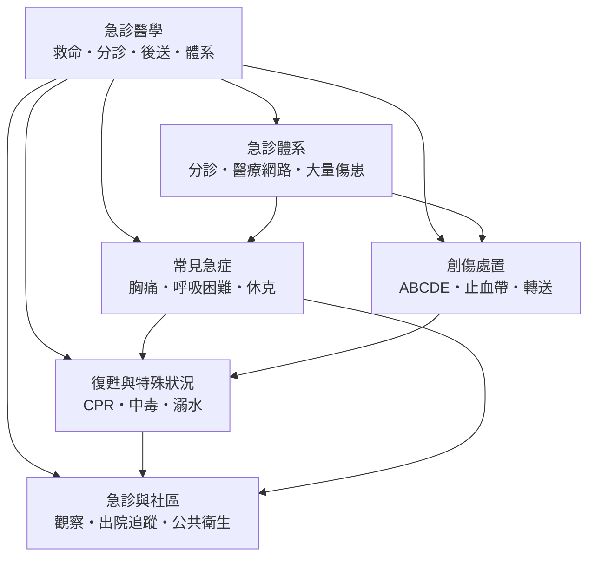

# 急診醫學

> 隸屬：第一層 [醫]　·　相關分類：[內科]、[外科]、[公共衛生]、[醫療衛生政策]　·　子分類總表見 [README]

> 對應維基百科：[中文維基百科：急诊医学]　·　[English Wikipedia: Emergency medicine]

急診醫學是處理「時間敏感、資訊不足、任何年齡任何病」的醫學部門。它與 [內科]、[外科] 最大的不同不在疾病種類，而在**決策模式**：病人常在病發後數分鐘到數小時內抵達，診斷未明、病史闕如，而且每一分鐘的延誤都可能不可逆——心跳停止、大量出血、中風與心肌梗塞都有以分鐘計的黃金時間。急診醫學因此發展出一整套以「先救命、後診斷」為綱的方法學：ABCDE 評估、分診、復甦流程與大量傷患指揮。

## 核心問題

1. **誰先看**：資源有限而病人同時湧入，分診制度以病情危急度（而非到達順序）排序，是急診的第一道數學。
2. **先做什麼**：ABCDE（呼吸道、呼吸、循環、神經、暴露）把「可能很快死掉的問題」按順序找出並即時處理；診斷在救命之後。
3. **留院或轉送**：急診是樞紐而非終點——留院觀察、收住院、轉院或出院追蹤，每一條路都要在資訊不足下權衡風險。
4. **體系如何撐住**：單一急診的能力有上限，救護車調度、醫療網路與大量傷患演習，讓「一家醫院的事」升級為「一個地區的系統」。

## 因果鏈

1. **戰場與意外的外科遺產**：止血帶、固定與後送的經驗來自戰爭與礦災；「傷患在第一小時內死於可預防的原因」這一觀察，是整門學科的起點。
2. **救護車從運送工具變成治療場所**：二十世紀中葉起，救護技術員的訓練、心臟去顫器與現場插管，使救護車從「快馬加鞭的計程車」變成行動的急診室。
3. **心肺復甦的科學化**：[薩法爾] 在 [1957年] 推廣口對口人工呼吸，[1960年] 閉胸心臟按壓發表後，A–B–C 的復甦流程成形；急救從醫院內的技術變成全民可學的技能。
4. **急診專科與住院醫師訓練制度化**：1960–1970 年代美國率先設立急診醫學專科，把「什麼都會一點、關鍵是排序與速度」變成有課綱、有考試的正規訓練。
5. **分診與檢傷分級的標準化**：五級檢傷（如 ESI、加拿大 CTAS）把「誰先看」從經驗猜測變成可稽核的制度。
6. **創傷體系的建立**：[1976年] 之後 Advanced Trauma Life Support（ATLS）推廣到全球，分級醫院、轉送規則與創傷團隊使嚴重外傷的死亡率顯著下降。
7. **時間決定預後的證據化**：急性心肌梗塞的再灌流治療、急性中風的血栓溶解時間窗，把「快」變成有量化指標的品質要求——門到球囊時間、門到針時間成為醫院競賽。
8. **觀察醫學與社區延伸**：急診觀察單元、居家急症與出院追蹤，使急診從「閘門」演化為可調節住院壓力、連結社區的樞紐。

## 子分類的定位與相互驅動

- [急診體系] 是**骨架**：分診、急診科設定的動線、醫療網路與大量傷患計畫，決定了病人遇到的第一分鐘由誰、多快、以什麼裝備應對。
- [常見急症] 是**主戰場**：胸痛、呼吸困難、意識障礙與休克占急診重病症的大宗，其鑑別診斷與時限治療是急診醫師的基本功。
- [創傷處置] 是**方法學的示範**：ABCDE、止血帶與頸椎保護把「先救命後診斷」具體化；這套流程反過來被移植到所有急症的最初評估。
- [復甦與特殊狀況] 是**極端情境**：心跳停止、中毒、溺水與電擊代表常規流程失效的邊界，其復甦技術與解毒劑庫存是急診能力的極限測試。
- [急診與社區] 是**出口**：急診觀察、出院與追蹤、居家急症把急診與 [公共衛生] 連接，讓「看完急診」不變成「再度回到急診」。

## 範例：一位胸痛病人的前十小時

1. **到院前**：救護員判讀十二導程心電圖，疑為急性心肌梗塞，直接通知心導管室啟動——救護車此刻已是治療場所。
2. **分診**：到院即以最高檢傷等級進入復甦室，跳過等候區；分診制度的價值在此展現。
3. **ABCDE 初評**：呼吸道通暢、呼吸音對稱、血壓偏低、意識清楚——循環問題列為首要，建立靜脈通路、抽血驗心肌酵素。
4. **時限治療**：心電圖顯示 ST 段上升，與心導管團隊確認後執行緊急心導管；「門到球囊時間」壓在九十分鐘內。
5. **觀察與出院決策**：術後轉入加護病房；對照組——非典型胸痛、酵素正常者進入急診觀察單元，數小時後複驗，才決定出院或住院。
6. **社區延伸**：出院時安排門診與心臟復健追蹤，衛戒症狀與再次就醫管道——急診的結束是社區照護的開始。

## 容易混淆之處

- **急診不是「先到先看」**：檢傷以危急度排序；輕症久候不是制度失靈，而是重症插隊的必然代價。
- **急診不是診所的深夜版**：急診的任務是穩定與分流，不是完整診斷與慢性病管理；「來急診開慢性藥」扭曲了資源配置。
- **復甦成功不等於治癒**：心跳恢復只是第一步，缺氧造成的腦部損傷決定最終預後，因此「搶時間」與「保護腦」同等重要。
- **休克不等於低血壓**：休克是組織灌流不足，血壓正常甚至偏高的代償期也可能已經休克。
- **外傷病人「看起來還好」會變化**：年輕人以代償掩蓋失血，生命徵象一旦崩潰往往急轉直下；反覆再評估是創傷處置的鐵律。

## 延伸閱讀

- [內科]：胸痛、休克等急症的鑑別診斷基礎。
- [外科]：創傷手術與緊急處置的技術來源。
- [公共衛生]：大量傷患、災害應變與急救教育的體系面。
- [醫療衛生政策]：急診給付、醫療網路與分級醫療的政策框架。
- [危機事件]：災害與大量傷患的社會面。
- [自然災害]：災害應變中急診體系的角色。

## 連結定義

[醫]: ../README.md
[README]: README.md
[內科]: ../內科/README.md
[外科]: ../外科/README.md
[公共衛生]: ../公共衛生/README.md
[醫療衛生政策]: ../../社會/醫療衛生政策/README.md
[危機事件]: ../../其他/危機事件/README.md
[自然災害]: ../../地/自然災害/README.md
[急診體系]: 急診體系.md
[常見急症]: 常見急症.md
[創傷處置]: 創傷處置.md
[復甦與特殊狀況]: 復甦與特殊狀況.md
[急診與社區]: 急診與社區.md
[薩法爾]: ../../人/醫學家/薩法爾.md
[1957年]: ../../時/1957年.md
[1960年]: ../../時/1960年.md
[1976年]: ../../時/1976年.md
[English Wikipedia: Emergency medicine]: https://en.wikipedia.org/wiki/Emergency_medicine
[中文維基百科：急诊医学]: https://zh.wikipedia.org/wiki/%E6%80%A5%E8%AF%8A%E5%8C%BB%E5%AD%A6
