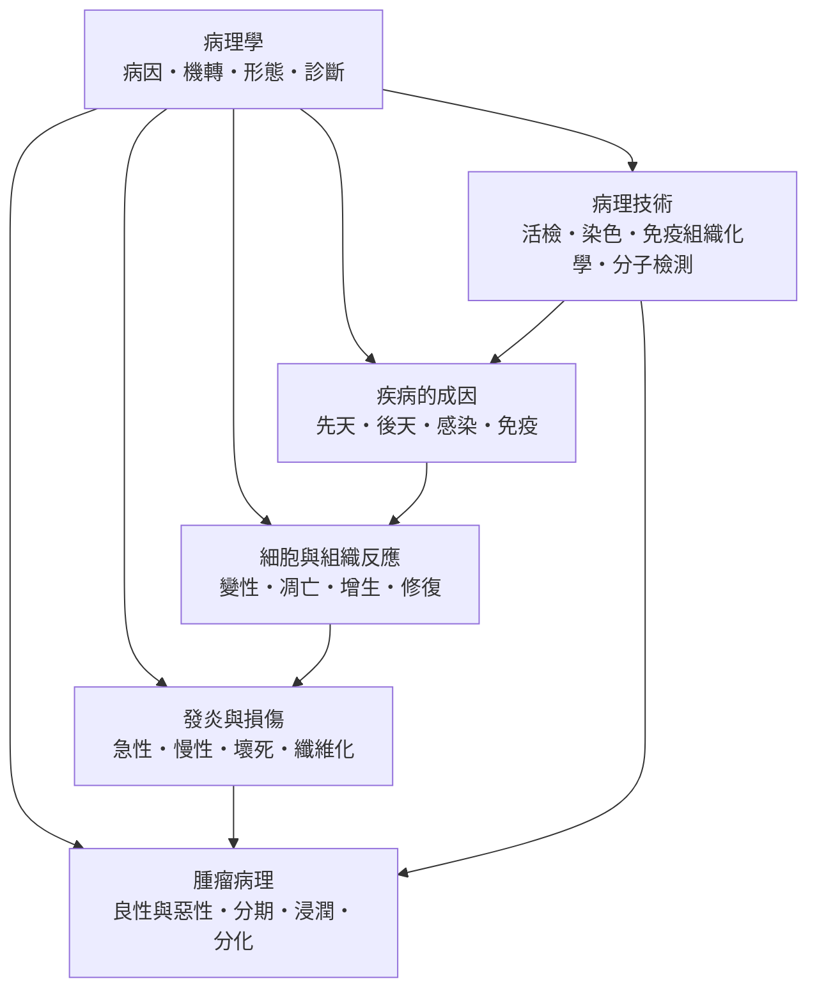

# 病理學

> 分類範圍：研究身體「為什麼生病」的部門——疾病的成因、細胞與組織對損傷的反應、發炎與修復的過程、腫瘤的生物學行為，以及把這些知識用於診斷的技術。　·　隸屬第一層：[醫]　·　相關分類：[生理學]、[免疫系統]、[解剖學]　·　子分類總表見 [README]

> 對應維基百科：[中文維基百科：病理学](https://zh.wikipedia.org/wiki/%E7%97%85%E7%90%86%E5%AD%A6)　·　[English Wikipedia: Pathology](https://en.wikipedia.org/wiki/Pathology)

病理學是醫學與基礎科學之間的橋梁：[生理學] 說明身體**如何運作**，病理學說明**運作如何出錯、出錯之後會發生什麼**。它回答四個層層相扣的問題——為什麼會生病（成因）、生病時細胞發生了什麼（細胞反應）、身體如何動員對抗（發炎與修復）、以及當這些控制失靈時如何失控（腫瘤）。最後，這些知識要變成診斷，必須依賴一整套從取樣到觀察的技術。

## 核心問題：從病因到病變的因果鏈

病理學的中心模型是：**病因（etiology）→ 發病機轉（pathogenesis）→ 形態變化（morphology）→ 臨床表現（clinical manifestations）**。

1. **病因**：啟動疾病的事件或因子，例如感染原、基因突變、毒素、血流中斷。
2. **發病機轉**：病因如何在細胞與分子層級逐步造成功能與結構的改變。
3. **形態變化**：可以看見、可以量測的變化——細胞腫脹、脂肪堆積、組織壞死、腫瘤浸潤。
4. **臨床表現**：症狀、徵象與檢驗數值，是上述過程對病人的呈現。

現代病理學的實證基準之一是正常範圍的量化。例如成人靜止心跳的正常參考區間約為每分鐘 $60 \sim 100$ 次，動脈血pH的生理範圍約在 $7.35 \sim 7.45$ 之間；偏離這些區間本身不是診斷，而是提示病因存在的線索，必須放回因果鏈中解釋。

## 因果鏈

1. **體液學說的統治與鬆動**：古希臘的四體液說把疾病歸因於體內液體失衡，這個框架統治了近兩千年，優點是提供系統性解釋，缺點是不可檢驗。
2. **病理解剖的誕生**：十八世紀起，醫師開始系統性地把臨床症狀與遺體解剖所見對照，疾病第一次被定位到**器官的形態變化**。
3. **細胞層級的確立**：[魏爾嘯] 在 [1858年] 出版《細胞病理學》，提出「疾病是細胞的疾病」——所有病變都能追溯到細胞層級的變化，把病理學從器官描述推向細胞機制。
4. **微生物病因論**：巴斯德與科赫證明特定微生物造成特定疾病，使「感染」成為可以確認、預防與治療的病因類別，也逼出免疫反應的研究。
5. **實驗病理與分子機轉**：動物模型、細胞培養與生物化學方法讓發炎、壞死、修復的過程可以在實驗室重現與拆解。
6. **腫瘤病理的系統化**：顯微鏡診斷、腫瘤分類與分期系統的建立，使癌症診斷從「有無腫塊」進步到「什麼類型、長到哪裡、分化多好」。
7. **技術革命**：組織染色、免疫組織化學與分子檢測讓診斷不再只靠形態，而能讀出細胞表面的蛋白與細胞內的基因變化。
8. **回到臨床**：現代病理診斷直接決定治療方案——同一個器官的腫瘤，因分子特徵不同而用完全不同的標靶藥物。

## 子分類的定位與相互驅動

- [疾病的成因] 是**起點**：把疾病分成先天與後天兩大來源，再依感染、免疫等機制細分；成因不同，後續所有反應就不同。
- [細胞與組織反應] 是**單位**：任何病因最終作用在細胞上，細胞以變性、凋亡、增生或修復回應，這是所有病變的共同語言。
- [發炎與損傷] 是**動員**：血管與免疫細胞的反應把局部損傷放大成可見的病程，也是慢性病與纖維化的核心機制。
- [腫瘤病理] 是**失控**：增生與修復的控制失效之後的極端結果，其分類與分期直接決定臨床處置。
- [病理技術] 是**驗證**：上述所有知識要變成可靠的診斷，必須透過活檢取樣、染色呈現與分子確認；技術的極限就是診斷的極限。

## 範例：一個心肌梗塞的完整病理鏈

以冠狀動脈粥樣硬化斑塊破裂造成的心肌梗塞為例，五個子分類全部登場：

1. **成因**：後天因素——高血壓、高血脂、吸菸長期作用，造成冠狀動脈內膜下的粥樣斑塊。
2. **細胞反應**：斑塊破裂後血小板聚集形成血栓，血流中斷，心肌細胞在缺血數分鐘內出現可逆的變性；缺血超過約 20 分鐘即開始走向不可逆的凝固性壞死。
3. **發炎與損傷**：壞死組織引發急性發炎，中性球先到、巨噬細胞清理殘骸，之後肉芽組織長入，數週後形成纖維化瘢痕。
4. **臨床意義**：瘢痕組織不會收縮，若範圍過大，心臟的幫浦功能永久受損——這解釋了為什麼「搶時間再灌流」是治療的核心。
5. **技術驗證**：臨床上以心電圖與心肌酵素判斷，病理解剖上則以染色確認壞死範圍；診斷標準本身就是病理知識的濃縮。

## 容易混淆之處

- **病因不等於機轉**：「抽菸導致肺癌」說的是病因；它經由哪些分子事件造成癌變，是發病機轉，兩者不可混用。
- **發炎不是單純的「紅腫熱痛」**：這四個徵象只是急性發炎的外觀；慢性發炎可以完全沒有這些表現。
- **壞死與凋亡不同**：壞死是意外性的細胞死亡，會引發發炎；凋亡是計畫性的細胞自殺，通常不引發發炎。
- **良性與惡性不是以大小區分**：判準是侵犯與轉移的能力，不是腫瘤體積。
- **病理診斷是機率判斷**：即使最好的技術，也有取樣誤差與判讀者間差異；「病理是黃金標準」指的是在現有證據中最可靠，而非絕對正確。

## 延伸閱讀

- [生理學]：正常功能的規則，病理學的對照組。
- [免疫系統]：發炎與免疫病因的機制基礎。
- [解剖學]：器官結構的知識，閱讀病變地圖的座標系。
- [微生物學]：感染性病因的主體學科。
- [遺傳學]：先天與分子病因的基礎。
- [內科]：把病理診斷轉成治療決策的臨床端。

## 連結定義

[醫]: ../README.md
[README]: README.md
[生理學]: ../生理學/README.md
[免疫系統]: ../免疫系統/README.md
[解剖學]: ../解剖學/README.md
[微生物學]: ../微生物學/README.md
[遺傳學]: ../遺傳學/README.md
[內科]: ../內科/README.md
[疾病的成因]: 疾病的成因.md
[細胞與組織反應]: 細胞與組織反應.md
[發炎與損傷]: 發炎與損傷.md
[腫瘤病理]: 腫瘤病理.md
[病理技術]: 病理技術.md
[魏爾嘯]: ../../人/醫學家/魏爾嘯.md
[1858年]: ../../時/1858年.md