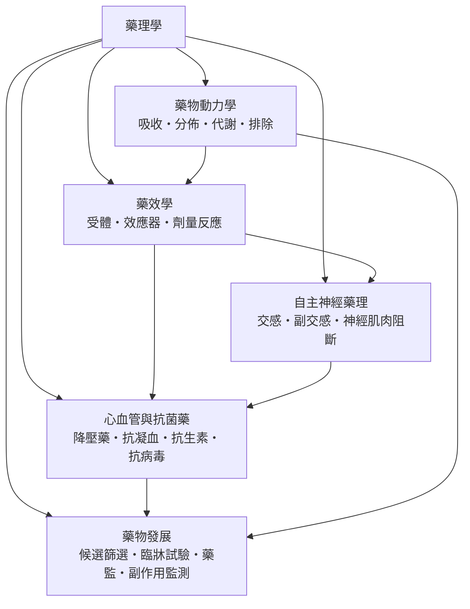

# 藥理學

> 隸屬：第一層 [醫]　·　相關分類：[生理學]、[化學]、[藥學]、[微生物學]　·　子分類總表見 [README]

> 對應維基百科：[中文維基百科：藥理學]　·　[English Wikipedia: Pharmacology]

藥理學研究**藥物與生物體之間的相互作用**，回答兩個對稱的問題：身體對藥做什麼（藥物動力學），以及藥對身體做什麼（藥效學）。它的中心物件是分子與受體：藥物以適當的劑型進入體內，經吸收、分佈、代謝與排除四個過程遊走全身，最後在作用部位與 [受體] 結合，產生治療效應或不良反應。藥理學的核心數學語言是劑量—反應關係與房室模型，例如描述血中濃度的一階排除方程：

$$
\frac{dC}{dt} = -k \, C, \qquad C(t) = C_0 \, e^{-kt}
$$

其中 $C$ 是血中藥物濃度， $k$ 是排除速率常數；由它導出的半衰期 $t_{1/2} = 0.693 / k$ 決定了「一天吃三次藥」還是「一天一次」。

在醫學體系中，藥理學佔據**轉譯層**的位置：往下，它用 [化學] 的分子結構與 [生理學] 的受體—訊息傳遞解釋藥物為何有效；往上，它為 [內科] 與臨牀各科提供用藥的劑量、禁忌與合併原則。與 [藥學] 的分工在於：藥學關心「如何把藥做成可用之劑型並交付病人」，藥理學關心「藥在體內如何起作用」。兩者共用藥物動力學的數學，但問題意識不同。

藥理學成為獨立學科的關鍵是**定量革命**。19 世紀前，用藥靠經驗累積與典籍記載，劑量全憑醫者手感；1847 年 [布赫海姆] 提出藥物作用應以劑量定量描述，使藥理學從描述走向實驗；1878 年蘭利提出受體概念，為「藥為何選擇性作用」找到分子答案；20 世紀中葉，房室模型與受體動力學把用藥變成可計算的工程問題。

## 核心問題

藥理學的四個核心問題彼此嵌套。

1. **到得了嗎**：藥物從給藥部位到達作用部位的能力，由吸收、分佈、代謝、排除四個過程（合稱 ADME）決定；這是 [藥物動力學] 的範圍。生物利用度是量化指標，例如口服藥因肝臟首渡效應可能只剩靜脈注射的幾成進入體循環。
2. **有作用嗎**：藥物與 [受體] 結合後能否改變細胞功能？親和力決定結合強度，內在活性決定結合後的效果；這是 [藥效學] 的範圍。
3. **安不安全**：治療指數 $TI = TD_{50} / ED_{50}$ 衡量有效劑量與中毒劑量的距離；治療指數窄的藥（如地高辛、華法林）需要監測血中濃度。
4. **如何造出更好的藥**：從受體結構出發設計新分子、經 [候選篩選] 與 [臨牀試驗] 驗證、最後由 [藥監] 機構把關；這是 [藥物發展] 的範圍。

四者的邏輯順序：先懂藥怎麼走（動力學），才懂藥怎麼起效（效應是濃度的函數）；先量化效應與毒性，才能評估安全邊際；有了這些語言，新藥開發才從煉丹變成系統工程。

## 因果鏈

1. **經驗用藥時代**：從草藥典籍到 19 世紀的鴉片酊與毛地黃，藥物有效但劑量憑經驗，中毒與無效並存；瓶頸在於「沒有量化的劑量—反應語言」。
2. **定量藥理的誕生**：1847 年 [布赫海姆] 在愛沙尼亞多爾帕特建立第一個藥理學講座，主張藥物作用可測、可比、可算，藥理學脫離治療學成為實驗科學。
3. **受體概念的確立**：1878 年蘭利以阿托品與毛果芸香鹼的拮抗實驗推論體內有「接受物質」，1905 年 [埃利希] 提出「 corpora non agunt nisi fixata（不解結則不起作用）」，受體學說成形。
4. **化學治療革命**：1910 年胂凡納明治梅毒、1935 年 [多馬克] 的磺胺、1928 年 [弗萊明] 發現青黴素並於 1940 年代量產——[微生物學] 與 [化學] 合流，感染症的死亡率驟降。
5. **動力學的數學化**：1937 年 Teorell 提出房室模型，此後半衰期、清除率、生物利用度成為標準參數，給藥間隔與劑量可用公式預測，而非反覆試錯。
6. **分子藥理學**：1960–1980 年代放射性配體結合實驗、離子通道鉗制與分子選殖，使受體從假說變成可定序的蛋白質；G 蛋白偶聯受體家族成為近半數藥物的標的。
7. **理性設計與法規化**：1960 年代沙利竇邁事件催生現代藥證制度；組合化學、高通量篩選與後來的結構生物學把 [藥物發展] 推向以結構為起點的理性設計。
8. **轉譯與個體化**：藥物基因組學解釋為何同一劑量對不同人效果迥異，治療藥物監測與基因分型把「標準劑量」推向「個體化劑量」，也反過來提出新的動力學問題。

## 子分類的定位與相互驅動

- [藥物動力學] 是**運輸系統**：回答藥在體內的時間—濃度問題；沒有它，劑量與給藥間隔只能瞎猜。
- [藥效學] 是**作用原理**：受體、劑量—反應曲線與治療指數都在這裡；動力學給出濃度，效應學把濃度翻譯成療效。
- [自主神經藥理] 是**經典試金石**：交感與副交感神經的傳遞物質最先被闡明，成為受體學說與選擇性藥物的示範場域；今日降壓藥與氣喘藥的設計邏輯皆源於此。
- [心血管與抗菌藥] 是**臨牀主戰場**：高血壓、血栓與感染是最大宗的用藥需求，把動力學與效應學的原則推向大規模應用，也養活了整個製藥產業。
- [藥物發展] 是**出口與入口**：把前三者的知識變成上市新藥，又以臨牀發現（新 [副作用監測] 訊號、新耐藥機制）反哺基礎研究。

## 範例：一次給藥的濃度計算

**問題**：某藥半衰期 4 小時，單次靜脈注射後血中濃度為 8 mg/L，8 小時後濃度為何？若有效濃度須維持在 2 mg/L 以上，多久要補一劑？

1. **算排除速率常數**： $k = 0.693 / 4 = 0.173$ 每小時。
2. **套指數衰減**：8 小時後 $C = 8 \times e^{-0.173 \times 8} = 8 \times e^{-1.386} \approx 2.0$ mg/L——恰好半衰期的兩倍時間，濃度剩四分之一。
3. **判斷補藥時間**：濃度從 8 降到 2 需要 2 個半衰期，即 8 小時；因此給藥間隔不得超過 8 小時，臨牀上常取其一半（每 4 小時）以留安全餘裕。
4. **臨牀意義**：這正是抗生素給藥「一天四次」的由來；把間隔拉長到一天一次，必須改用半衰期長的長效劑型或提高劑量——劑型設計與 [藥學] 的接點就在這裡。
5. **延伸**：若病人腎功能只剩一半， $k$ 減半、半衰期延長為 8 小時，同樣間隔會造成蓄積中毒——劑量必須依清除率調整，這是 [藥物動力學] 直接救人命的地方。

## 容易混淆之處

- **藥理學不等於藥學**：藥學偏劑型、調劑與藥事管理，藥理學偏作用機轉與效應；兩者共用藥物動力學，但問題不同。
- **半衰期不等於作用時間**：藥物濃度可能早已低於偵測極限，作用仍持續（如阿斯匹林對血小板的不可逆抑制）；反過來，濃度尚高而耐受性已使作用消失。
- **效價不等於效能**：效價（potency）是達到某效應所需的劑量，效能（efficacy）是最大可能效應；藥效弱但效能高的藥，臨牀上常優於效價高而效能低的藥。
- **拮抗劑與反轉錄激動劑不同**：單純拮抗劑不產生自身效應；反轉錄激動劑會降低受體的基礎活性，兩者劑量—反應行為不同。
- **副作用與毒性反應不同**：副作用是治療劑量下的附帶效應（可預期），毒性是超量或蓄積造成（常與劑量成正比）。
- **抗生素不等於消炎藥**：抗生素對付微生物，對非感染性發炎無效；「發炎就吃抗生素」是常見而危險的誤用。

## 延伸閱讀

- [生理學]：受體與訊息傳遞的母理論。
- [化學]：藥物分子設計的基礎。
- [藥學]：劑型與臨牀藥事的上游。
- [微生物學]：抗菌與抗病毒藥的標的來源。
- [免疫系統]：疫苗、抗體藥物與過敏反應的舞臺。
- [中草藥]：傳統藥材的現代藥理驗證，青黴素之外的另一條藥物來源。

## 連結定義

[醫]: ../README.md
[README]: README.md
[生理學]: ../生理學/README.md
[化學]: ../化學/README.md
[藥學]: ../藥學/README.md
[微生物學]: ../微生物學/README.md
[內科]: ../內科/README.md
[免疫系統]: ../免疫系統/README.md
[中草藥]: ../中草藥/README.md
[布赫海姆]: ../../人/生物學家/布赫海姆.md
[埃利希]: ../../人/生物學家/埃利希.md
[多馬克]: ../../人/生物學家/多馬克.md
[弗萊明]: ../../人/生物學家/弗萊明.md
[藥物動力學]: 藥物動力學.md
[藥效學]: 藥效學.md
[自主神經藥理]: 自主神經藥理.md
[心血管與抗菌藥]: 心血管與抗菌藥.md
[藥物發展]: 藥物發展.md
[受體]: 受體.md
[候選篩選]: 候選篩選.md
[臨牀試驗]: 臨牀試驗.md
[藥監]: 藥監.md
[副作用監測]: 副作用監測.md
[中文維基百科：藥理學]: https://zh.wikipedia.org/wiki/%E8%8D%AF%E7%90%86%E5%AD%A6
[English Wikipedia: Pharmacology]: https://en.wikipedia.org/wiki/Pharmacology