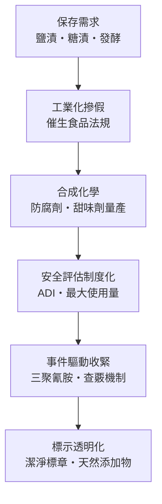

# 食品添加物

> 隸屬：第一層 [理]　·　相關分類：[科技]　·　子分類總表見 [README]

食品添加物指「在食品製造、加工、調配過程中特意添加，而非以一般食材方式食用、也不當作調味主體使用的物質」，目的在延長保存期限、改善色香味與質地、強化營養或方便製程作業。它是一門橫跨化學、微生物學、毒理學與法規管理的應用技術：既要懂得每種物質「為什麼有效」，也要知道「加多少安全」，還要讓消費者在包裝上看懂「加了什麼」。本條目說明食品添加物的前因後果、各子分類的分工，以及這門技術如何被歷史事件反覆重塑。

## 核心問題

食品從採收或屠宰的那一刻起就開始劣變：微生物繁殖造成腐敗、脂肪氧化產生油耗味、色素褪色、質地塌陷。人類因此面臨一個根本取捨——**保存與安全**（不加東西，食物很快壞掉，可能滋生肉毒桿菌等致命毒素）對上**風險與信任**（加了東西，就必須證明長期食用無害，並且如實標示）。食品添加物技術的整個發展史，就是在這條張力線上來回校正的過程。

用一句白話概括這門學科的算式：**效果 ÷ 風險 ÷ 用量**。對每種添加物，管理者會先由動物實驗找出「無不良作用劑量」（NOAEL，白話說：實驗中觀察不到任何有害效應的最高劑量），再除以通常 100 的安全係數，得到「每日容許攝取量」（ADI，白話說：終身每天吃這個量以下，被認為安全）：

$$ \text{ADI} = \frac{\text{NOAEL}}{100} \quad (\text{單位：mg／kg 體重／日}) $$

有了 ADI，才能推導各食品類別的「最大使用量」與標示義務，這正是子分類「安全評估」與「標示規範」的核心。

## 因果鏈

1. **前工業時代的瓶頸**：沒有冷藏技術，人類用鹽漬、糖漬、煙燻、發酵保存食物——這些其實就是最早的天然添加物（鹽、糖、香料都扮演防腐角色）。
2. **工業化與都市化**：十九世紀人口湧入城市，食品必須長途運輸與久放，市售食品摻假（例如以廉價色素冒充、以石膏混入奶粉）氾濫，直接催生了 1856 年後的合成染料管制與二十世紀初的食品法規（如 1906 年美國《聯邦食品與藥品法》）。
3. **化學合成時代**：有機化工讓防腐劑（如苯甲酸鈉）、抗氧化劑（如 BHA、BHT）、合成甜味劑（如糖精、阿斯巴甜）得以量產且成本低廉，食品工業因此能做出貨架期數月以上的加工食品。
4. **安全評估制度化**：1958 年美國食品添加物修正案確立「上市前須證明安全」的原則，聯合國 FAO／WHO 的 JECFA 專家會議建立 ADI 制度，「毒性試驗」從企業良心變成法定門檻。
5. **事件驅動的收緊**：2008 年三聚氰胺事件讓「非添加物名單內的非法添加」成為全球焦點，各國因此大幅強化查驗機制與檢驗方法（如以液相層析串聯質譜 LC-MS/MS 篩檢）。
6. **標示與消費者權益時代**：手機掃描條碼、潔淨標章（clean label）運動興起，廠商被迫以天然色素取代合成色素、縮短成分表，反過來驅動「天然添加物」與新萃取技術的研發。

## 子分類的定位與相互驅動

### 添加物的種類

依「功能」分類是整個體系的骨架：「防腐劑」抑制微生物（如苯甲酸鈉、己二烯酸鉀），「抗氧化劑」阻止油脂酸敗（如維生素 E、TBHQ），「甜味劑」提供甜味而不增加熱量（如蔗糖素、醋磺內酯鉀），「著色劑」恢復加工中損失的色澤（如食用黃色四號），「膨脹劑」讓麵團產生氣孔（如小蘇打與酸性劑的混合物）。功能分類之所以重要，是因為法規的「最大使用量」逐類規定，且同一功能常有多種選項，廠商可依 pH 值、加熱條件、法規上限挑選組合——例如同是防腐劑，苯甲酸鈉適合酸性飲料，己二烯酸鉀更適合中性烘焙品。而種類的擴張又逼出下一層需求：這麼多物質，如何證明安全？

### 安全評估

「安全評估」以「毒性試驗」（急性、亞慢性、慢性與致癌性試驗）取得 NOAEL，換算成「每日攝取量」（ADI），再落實為各食品類別的「最大使用量」。這個體系直接回應「種類擴張」帶來的風險：1958 年起，合成甜味劑糖精曾因動物膀胱癌疑慮被列入警示名單數十年，阿斯巴甜也在 2023 年被 WHO 的 IARC 列為「可能致癌物（2B 類）」但維持原 ADI——顯示「長期風險」的評估需要持續追蹤新證據，而非一次定案。評估結果又反向塑造種類名單：不安全的被除名，替代品則以新名目登場。

### 標示規範

安全評估的前提是「消費者知道吃了什麼、吃了多少」。「標示方式」規定成分表須以物品名或統一名稱列出並附用途名稱（如「甜味劑（蔗糖素）」），「過敏原標示」強制標出蝦蟹、花生、蛋、乳等過敏原——因為對極少數人而言，微量過敏原的風險遠超過 ADI 概念所能涵蓋。「天然標示」與「基因改造標示」則回應信任問題：當添加物名稱愈來愈像化學式，消費者的疑慮推動「潔淨標章」運動，廠商改用天然替代品，這又驅動了天然添加物的研究。

### 天然添加物

「天然添加物」從動植物或微生物取得：「香料」（如香草莢的香蘭素）、「色素」（如紅麴色素、β-胡蘿蔔素）、「維生素」（營養強化用的維生素 C、維生素 D）、「酵素」（如製乳用凝乳酶、高果糖漿生產用的異構化酶）。天然不等於自動安全——同樣需要毒性試驗與用量規範；但它在消費者信任與標示訴求上有優勢，因此成為合成添加物受限時的替代出口。酵素製劑的發展特別值得注意：它是「用生物製程取代化學添加」的典型，推動了食品工業酶技術的進步。

### 禁用與限制

「禁用與限制」是體系的最後防線：明訂「禁用物質」（如硼砂、吊白塊、三聚氰胺——皆不得用於食品）、「限定使用」的範圍與對象（如某些色素不得用於生鮮肉類以免掩蓋腐敗）、「查覈機制」（市場抽驗、邊境檢驗、源頭登錄）與「消費者權益」（申訴、退貨與求償管道）。這一子分類的存在證明了歷史的教訓：合法添加物制度再嚴密，仍須防堵「非名單內物質」的非法添加。

## 具體範例

**範例一：苯甲酸鈉如何在一瓶可樂裡工作。** 苯甲酸鈉（E 編號 E211）在酸性環境下轉為苯甲酸，能穿透微生物細胞膜、干擾其酵素系統，因此對 pH 3 至 4.5 的食品特別有效。一罐 pH 約 2.5 的碳酸飲料可合法添加至法規上限（台灣規定每公斤 0.6 公克以下），實際用量常低於上限就能達到抑菌效果。然而 2005 年的研究指出，苯甲酸鈉與飲料中的維生素 C 並存時可能生成微量苯（疑似致癌物），英國食品標準局因此在 2007 年檢討並鼓勵業者調整配方——這正是「安全評估的持續追蹤」與「禁用與限制」如何被新證據驅動的實例。

**範例二：三聚氰胺事件（2008）。** 三聚氰胺是工業用的化工原料，從來不是合法食品添加物。它的含氮量高，會讓用「凱氏定氮法」檢測蛋白質的結果虛增，中國不法業者因此把它摻入奶漿偽裝高蛋白含量，造成近三十萬名嬰幼兒泌尿道結石、至少六人死亡。事件後各國立刻採取行動：訂定乳品的「管理限量」（如嬰幼兒奶粉 1 mg/kg），並導入 LC-MS/MS 等直接測定三聚氰胺的檢驗方法，取代容易被騙的定氮法。這個案例說明三件事：非法添加的動機往往是「騙過檢驗方法」；查覈機制必須隨摻假手法進化；「添加物」與「非法添加物」在法規上是嚴格分離的兩個概念。

**範例三：DIY 計算一次 ADI 與最大使用量的關係。** 假設某甜味劑的 ADI 為每公斤體重每日 15 毫克，一名 60 公斤的成人每天上限就是 15 × 60 ＝ 900 毫克。法規若規定飲料每公升最多可添加 300 毫克，則這位成人每天即使喝下 3 公升該飲料，攝取量 900 毫克仍不超過 ADI——這正是「最大使用量」如何由攝食量調查回推、與 ADI 掛鉤的計算邏輯。若某族群（如兒童、體重較輕者）對同一食品的相對攝取量偏高，法規就會對該食品類別調降上限，甚至禁止使用。

**範例四：色素的信任拉鋸。** 1970 年代起，「南安普頓研究」發現多種合成著色劑（如食用黃色四號、食用紅色六號）可能與兒童過動有關，歐盟因此要求含這些色素的食品加註警語，許多廠商乾脆改用甜菜根紅、薑黃等天然色素。同一種功能需求（著色），在法規與消費者壓力下從合成路線轉向天然路線，體現了「種類—評估—標示—禁用」四個子分類的連鎖反應。

## 歷史時間軸速覽

- 古代：鹽、糖、煙燻與發酵是最早的「保存技術」，香料同時扮演調味與防腐。
- 1856 年：合成染料問世後迅速流入食品，摻假問題引發各國立法管制。
- 1906 年：美國《聯邦食品與藥品法》通過，食品摻假首次有全國性法律約束。
- 1958 年：美國食品添加物修正案確立「上市前須證明安全」；JECFA 建立 ADI 制度。
- 2008 年：三聚氰胺事件催生直接檢驗方法與管理限量，查驗機制全面升級。
- 2010 年代至今：潔淨標章運動與過敏原強制標示，把資訊透明變成產品競爭力。

## 容易混淆之處

- **添加物 ≠ 有害，天然 ≠ 無害**：防腐劑抑制肉毒桿菌是保命的功能；反之，天然來源的物質超量同樣有毒（如過量維生素 A）。
- **食品添加物 ≠ 非法添加物**：三聚氰胺、硼砂從未列於准用名單，屬於違法摻假，不應與受管制的合法添加物混為一談。
- **E 編號 ≠ 化學可怕**：E 編號只是歐盟對通過安全評估物質的編號系統，維生素 C 也有 E 編號（E300）。
- **ADI 與最大使用量的差別**：ADI 是人體終生每日可攝取量的評估值；最大使用量是法規對某食品類別允許的添加濃度，兩者由攝食量調查連結，不可互相取代。

## 與相鄰分類的關聯

- 與上位概念 [理](../README.md) 的關係：食品添加物是化學、毒理學與微生物學在餐桌上的應用，其安全評估方法論也反向餵養了風險科學。
- 與 [科技](../科技/README.md) 的關係：層析質譜、感測器與區塊鏈溯源等技術由科技領域流入食品查驗，讓「查覈機制」從抽樣檢驗走向全程監控。

## 連結定義

[理]: ../README.md
[科技]: ../科技/README.md
[README]: README.md
