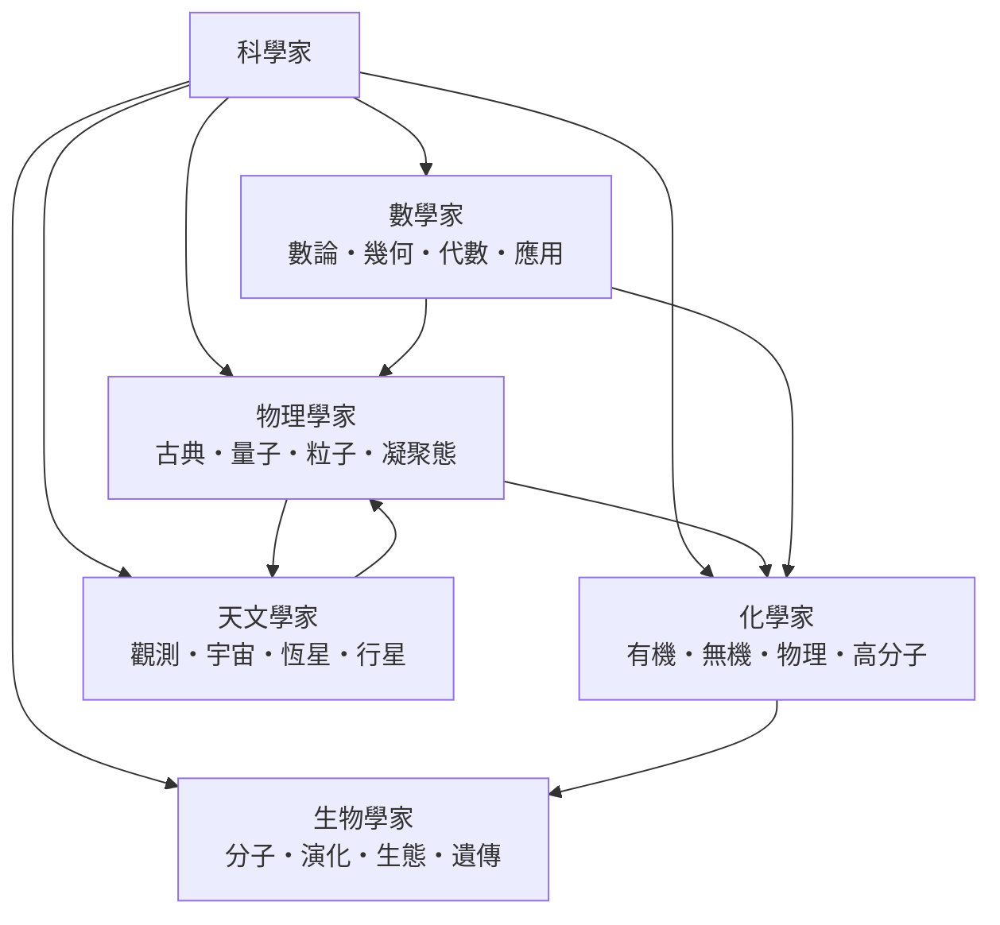

# 科學家

> 分類範圍：以自然世界為對象、以可重複的觀測與實驗為方法、並服從同行評審與公共批判規範從事知識生產的人；並敘述科學如何自希臘自然哲學起，經哥白尼革命與培根方法確立、化學革命量化、牛頓力學統一、統計方法介入，二十世紀走上班組化的大科學路線，最後在資料密集與跨領域協作時代重新分工。
>
> 隸屬第一層：[人]　·　相關分類：[物理學]、[化學]、[數學]、[生物學]、[天文學]、[科學史]　·　子分類總表見 [README]

> 對應維基百科：[中文維基百科：科學家](https://zh.wikipedia.org/wiki/%E7%A7%91%E5%AD%A6%E5%AE%B6)　·　[English Wikipedia: Scientist](https://en.wikipedia.org/wiki/Scientist)

## 核心問題：什麼東西讓「做研究的人」變成科學家

科學家不是「知道很多的人」，也不是「學歷很高的人」。科學家這個身分是由**一套方法規範**確定的：提出可被檢驗的問題、用可重複的操作取得資料、公開原始紀錄讓他人覆核、接受同行評審、並在預測失敗時修正自己的理論。

因此科學與科學家必須分開看：**科學**是可累積、可反駁、可公開共享的知識；**科學家**是生產這種知識的人。同一套知識可以被放棄科學方法的程序取得（例如占星術也做曆法計算），但那部分不會累積成科學。

方法的核心判準是**可重複性**（reproducibility）：同一實驗由不同團隊、不同時間、不同儀器重做，應得到統計上一致的結果。可重複性同時是科學與偽科學的分界，也是科學作為集體事業而非個人靈感的理由——單次觀測只是主張，重複觀測才是證據。

科學家的工作流程可以固定成六步，每一步都有制度支撐：

1. **提問**：把好奇轉成可答的問題（例如「行星軌道為何是橢圓」而非「宇宙為何這樣」）。
2. **假設與預測**：提出可用觀測否證的陳述，並推出「若假設成立，應看到什麼」。
3. **量測**：設計實驗或觀測，把誤差控制在可估計範圍內。
4. **統計判讀**：在 [機率統計] 的框架下區分「資料與假設一致」與「資料只是雜訊」。
5. **同儕評審**：未經他人檢查的結果不進入公共文獻。
6. **累積與修正**：結果寫入文獻、被後續研究引用、修正或推翻。

值得注意的是第三步與第四步：量測不是「讀出真值」，而是「在已知誤差下估計真值」。因此每個科學領域都需要一套**量測與誤差**的共同語言：物理學用 [力學] 與量綱分析，生物學用統計的樣本設計，化學用莫耳與濃度，天文學用視差與光度距離。

## 因果鏈

科學家這個群體的形成，是一連串瓶頸被逐一解決的結果：

1. **古希臘的自然哲學**建立了「以自然解釋自然」的目標，但亞里士多德的方法偏向權威論證與演繹，缺少決定性的經驗檢驗環節，這個缺口促成了近代科學。
2. **哥白尼 1543 年的《天體運行論》**把地球從中心移開，把計算而非權威放回中心，開啟 [科學革命]；接著第谷的精密觀測與開普勒 1609、1619 年的行星定律，把「數據 → 定律」的路線走通。
3. **伽利略 1632 年的《對話》**確立了「實驗 + 數學」雙軌：落體實驗反駁亞里士多德的水準拋物線說。他因此同時示範了科學的兩種武器，也示範了它與權力的衝突。
4. **培根 1620 年的《新工具》**提出歸納法，笛卡兒 1637 年的《方法論》提出演繹與懷疑方法——一實一虛兩條路徑在 19 世紀才被統計方法縫合起來，成為現代實驗科學。
5. **牛頓 1687 年的《自然哲學的數學原理》**是第一座真正的理論綜合：牛頓力學把天體與地面運動統一在同一套方程之下，並給出可計算的預測。這一步把科學家從「描述者」變成「預測者」。
6. **預測的回報催生了新的科學**：牛頓力學算出哈雷彗星 1758 年回歸，拉普拉斯 1796 年從天文觀測推算太陽系年齡，1846 年勒威耶與伽勒依天文學家依牛頓力學在海王星位置找到海王星。「用理論發現新物體」成為科學家社會最高的榮譽與最強的招募機制。
7. **拉瓦錫 1789 年的《化學基本論》**與道爾頓 1803 年的原子論，把化學也變成定量學科，化學家於是成為與物理學家平起平坐的一類科學家。
8. **19 世紀的統計化**：高斯、泊松、卡爾·皮爾遜（1900 年提出 p 值與显著性）與費歇（1925 年方差分析）把「資料如何支持假設」變成可計算的問題，科學方法從此有了統計語言。
9. **20 世紀的制度化與專業化**：領域期刊（例如 1904 年創刊的《物理學評論》）、研究所、國家實驗室、基金制（美國 1950 年成立 NSF）與諾貝爾獎制度，科學家從孤立的學者變成有職業路徑的制度性角色。
10. **跨界與大科學**：量子力學需要數學家（希爾伯特、馮·諾依曼）、化學家（群論、配位化學）與天文觀測（塞爾塞的量子力學解釋星光）；分子生物學需要物理學家的晶体學與化學家的結構化學；地質年代學需要物理學家的定年技術。這些交叉點是科學發展最快的區域。
11. **資料密集科學**：1970 年代以後，超算、網際網路與資料庫讓「資料量」本身成為生產力，生物資訊學、氣候模擬、基因體定序都因此改變了工作方式。

## 子分類的定位與相互驅動

### 物理學家

物理學家研究**物質與能量的基本行為**，並以少數公理加上數學推導建立可檢驗的模型。他們的核心資產是「定律＋方程＋量」：牛頓的 $ F = ma $ 、熱力學的 $ \Delta U = Q - W $ 、薛丁格的波函數方程，各自構成整個學科的骨架。物理學家的方法特徵是**高度理想化與數學化**，因此最容易跨領域移植，也因此長期為其他學科提供工具——例如半導體物理直接催生了資訊革命。

### 化學家

化學家研究**物質的組成、結構、性質與變化**，把微觀的鍵結與排列翻譯成宏觀的性質。他們的核心資產是「結構＋反應性」：lewis 結構式、配位數、官能基、位能面。化學家的方法特徵是**分類與合成能力**——先建立物質的秩序（元素週期表），再依規則製造新物質。化學是物理與生物之間的轉接層：物理化學把能量與平衡帶進化學，分子生物把化學帶進生物。

### 生物學家

生物學家研究**生命現象與生命系統**，與其他學科最大的差別在於對「演化」這個歷史性因素的承認：生物系統不僅遵從物理化學法則，還必須解釋它們「為何長成現在這樣」。生物學家的核心資產是「比較＋機制＋演化」三件套，方法特徵是**尺度跨度大**（從鹼基對到整個生物圈）與**模式生物的犧牲精神**（先研究容易的生物，再推及一般）。

### 數學家

數學家研究**結構本身**，不直接研究自然對象，而研究「一旦給定公理，哪些敘述必然為真」。數學家的核心資產是**證明**——一個不依賴觀察、只依賴邏輯必然性的論證。數學是科學的兩個極端：它最不依賴經驗，最嚴格；但它對其他學科的回報率極高，物理學的基本語言至今是微積分、線性代數與群論。數學家與科學家的界線並非恆定：歐拉、歐幾里得、拉普拉斯、傅立葉都同時身兼兩者。

### 天文學家

天文學家研究**宇宙中天體的分布、結構與演化**，是唯一以「不能在實驗室重現」為常態的科學家。因此天文學被迫發展出別的學科少用的能力：**從極微弱訊號中推論**（視差、光譜位移、引力波）、**用模型模擬不可及對象**（數值天體力學）、以及**以時間跨度換取資訊量**（數千億顆恆星成為統計樣本）。天文學的成果反過來檢驗物理學：1919 年日食觀測確認愛因斯坦的引力偏折，說明相對論不只停留在紙上。

## 容易混淆之處

- **科學家不等於科學**。科學是一套知識與程序；科學家是執行這套程序的人。批評某位科學家的結論，不等於否定科學作為制度。
- **諾貝爾獎不是科學的最高榮譽**，而且它有物理、化學、生理或醫學三個領域的硬性限制，數學、地質學與生態學家長期無獎可拿，獲獎也常集中在少數國家。
- **學歷與頭銜不等於研究品質**。2010 年代以來的可重複性研究顯示，許多知名實驗室發表的結果無法被重做，這是制度問題而非個別科學家的道德問題。
- **「客觀中立」是有爭議的說法**。參與式觀察（由研究者自身參與研究對象）意味著觀測與解釋從未完全分離；性別、國籍與資源分布也真實地影響了誰有條件做研究。
- **科學方法不保證結論為真**。它保證的是「結論經得起公開的批評與修正」，這是較弱但更可靠的保證。
- **先驅者未必是對的那一方**。例如丹麥天文學家 Tycho Brahe 的精密觀測支持了第谷的世界體系，但正是這批資料讓開普勒得出了正確的橢圓軌道定律。

## 條目索引

- [物理學家]、[化學家]、[生物學家]、[數學家]、[天文學家]
- [古典物理]、[量子物理]、[粒子物理]、[凝聚態物理]
- [有機化學]、[無機化學]、[物理化學]、[高分子化學]
- [分子生物]、[演化生物]、[生態學]、[遺傳學]
- [數論]、[幾何]、[代數]、[應用數學]
- [觀測天文]、[宇宙學]、[恆星物理]、[行星科學]

## 連結定義

[人]: ../人/README.md
[README]: README.md
[物理學]: ../物理學/README.md
[化學]: ../化學/README.md
[數學]: ../數學/README.md
[生物學]: ../生物學/README.md
[天文學]: ../天文學/README.md
[科學史]: ../科學史/README.md
[科學革命]: ../科學革命/README.md
[力學]: ../力學/README.md
[機率統計]: ../機率統計/README.md
[物理學家]: 物理學家.md
[化學家]: 化學家.md
[生物學家]: 生物學家.md
[數學家]: 數學家.md
[天文學家]: 天文學家.md
[古典物理]: 古典物理.md
[量子物理]: 量子物理.md
[粒子物理]: 粒子物理.md
[凝聚態物理]: 凝聚態物理.md
[有機化學]: 有機化學.md
[無機化學]: 無機化學.md
[物理化學]: 物理化學.md
[高分子化學]: 高分子化學.md
[分子生物]: 分子生物.md
[演化生物]: 演化生物.md
[生態學]: 生態學.md
[遺傳學]: 遺傳學.md
[數論]: 數論.md
[幾何]: 幾何.md
[代數]: 代數.md
[應用數學]: 應用數學.md
[觀測天文]: 觀測天文.md
[宇宙學]: 宇宙學.md
[恆星物理]: 恆星物理.md
[行星科學]: 行星科學.md
